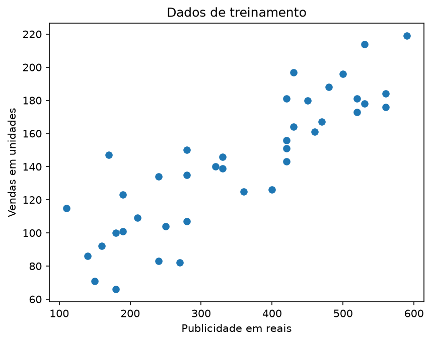
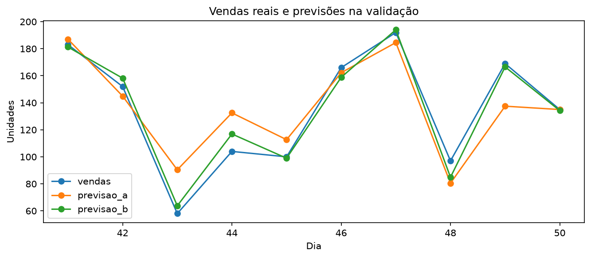
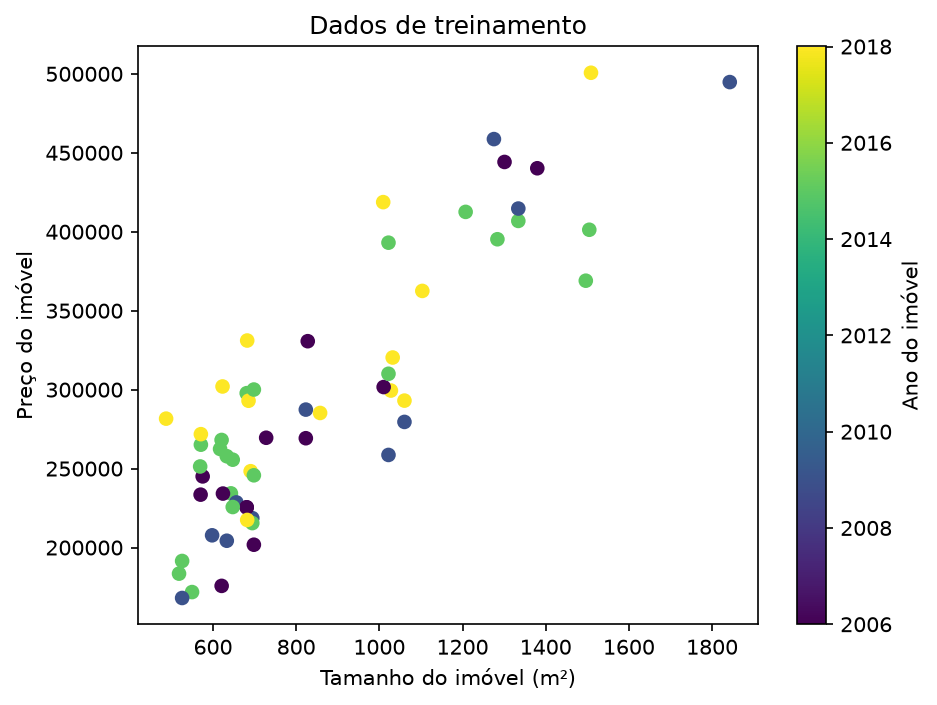
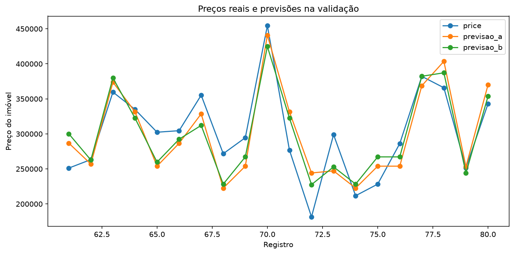

# Aprendizagem de Máquina

Projeto de análise e previsão utilizando Regressão Linear, com dois exercícios práticos.

## 01. Previsão de Vendas

Utiliza dados de publicidade e desconto para estimar a quantidade de vendas.

- **Modelo A:** utiliza publicidade como entrada.
- **Modelo B:** utiliza publicidade e desconto como entradas.

### Dados de Treinamento

### Comparação da Validação

### Resultados

- **MAE Modelo A:** 14,40 unidades.
- **MAE Modelo B:** 5,22 unidades.
- **Modelo escolhido:** B.
- **MAE no teste:** 6,23 unidades.
- **Nova previsão:** 129,71 unidades.

Resultado da execução: [resultadoTerminal.md](./resultadoTerminal.md)

---

## 02. Previsão de Preços de Imóveis

Utiliza Regressão Linear Múltipla para estimar o preço de imóveis com base em duas variáveis:

- **Modelo A:** utiliza o tamanho do imóvel (`size`).
- **Modelo B:** utiliza o tamanho (`size`) e o ano (`year`).

### Dados de Treinamento

### Comparação da Validação

### Resultados

Os resultados dos modelos, os MAEs de validação, a escolha do modelo e a avaliação no teste estão registrados na saída do terminal.

Resultado da execução: [resultadoTerminal2.md](./resultadoTerminal2.md)
